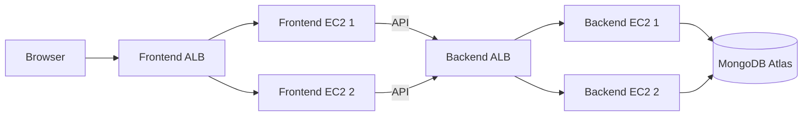

# TravelMemory on AWS

**deployment summary**

| Repository | [github.com/UnpredictablePrashant/TravelMemory](https://github.com/UnpredictablePrashant/TravelMemory) |

## Project

TravelMemory is a MERN app for sharing travel experiences. The React frontend talks to a Node.js/Express API, with MongoDB Atlas storing the trip data.

For this deployment, the frontend and backend each run on two EC2 instances. Nginx serves the frontend and proxies backend requests. Each tier has its own Application Load Balancer (ALB), and systemd keeps the backend running after reboots. Cloudflare is not used; the app is reached through the frontend ALB DNS name.

## Architecture

## Deployment at a Glance

1. Create a MongoDB Atlas cluster and database user. Keep the connection string private.
2. Launch Ubuntu 22.04 instances named `backend-master` and `frontend-master`, then clone the repository.
3. Configure the backend `.env`, install dependencies, and run the service with systemd. For this deployment, set `PORT=3000`. Nginx proxies port `80` to the local Node.js service.
4. Build the React frontend with `REACT_APP_BACKEND_URL` set to the backend master address. Serve the build with Nginx and verify the app before imaging.
5. Create one AMI per master, then launch `backend-2` and `frontend-2` from those images.
6. Create a target group and ALB for each tier. Use `/health` for the backend health check and `/` for the frontend.
7. Update and rebuild the frontend with the backend ALB address. Deploy the build to both frontend instances.
8. Open the frontend ALB DNS name.

## Verification

- Both frontend and backend target groups show two healthy instances.
- The backend health endpoint responds at `/health`.
- Trips load through the frontend and backend ALBs from MongoDB Atlas.
- A newly added experience saves and appears in the list.

## Security Notes

Restrict SSH to trusted IP addresses, allow instance traffic only from the relevant ALB where possible, and limit Atlas network access to the backend. Do not commit `.env` files or expose backend port `3000` publicly. Use HTTPS for production traffic. Uploaded files stored on an instance are not shared across backend instances; use shared storage such as Amazon S3 if uploads need to be available from every instance.

## Submission

- Deployment screenshots: `docs/screenshots/`
- Architecture: [SVG image](docs/screenshots/02-architecture.svg) 
- Source code: [GitHub repository](https://github.com/UnpredictablePrashant/TravelMemory)
